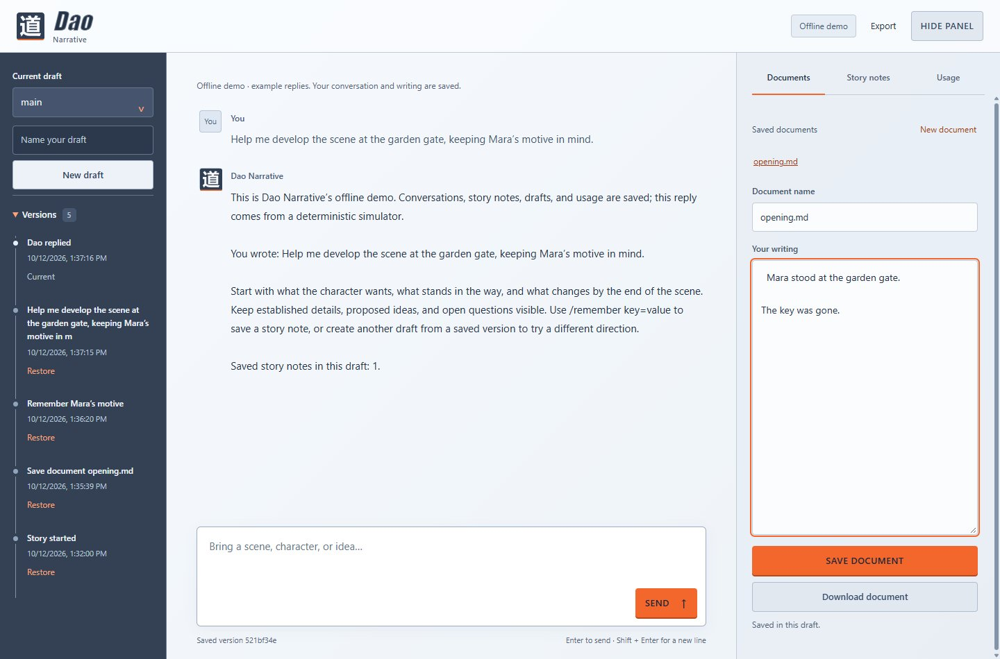

# Dao Narrative

Dao Narrative is a local writing room for scenes, characters, and alternate endings. It keeps your conversation, story notes, documents, drafts, and saved versions. You decide what becomes canon.



## Launch

```sh
python -m dao_narrative
python -m dao_narrative --terminal
```

The browser defaults to **http://127.0.0.1:8766**. After `pip install .`, use `dao-narrative` or `dao-narrative-terminal`.

On Windows, extract the separate Dao Narrative ZIP and run:

```powershell
.\DaoNarrative.exe
.\DaoNarrative.exe --web --open-browser
```

The app starts with deterministic offline demo replies. Enable live AI with the shared `DAO_*` and `OPENAI_API_KEY` process environment settings; `.env` files are not loaded automatically. Live replies use writing-specific instructions and receive the current conversation, saved story notes, and saved documents. The model has no tools and cannot save or change your writing itself. Provider requests and usage accounting retain the same bounds as Dao.

## Write and revise

- Bring a scene, character, or idea to the conversation. Ask for concrete prose, feedback, or alternate directions.
- Open **Documents** to write or paste a scene. Give it a name and select **Save document**. Open a saved document to revise it; each save creates a version. Blank drafts and unfinished writing can be saved. Leading indentation and trailing newlines are preserved. Documents support up to 32,768 characters, with up to 100 documents per draft.
- Use **Download document** to save the editor's current text as a file, including unsaved edits.
- Open **Story notes** to keep character details, established facts, or open questions. Select an existing note to edit it. Notes accompany live model replies.
- Create a **New draft** to try another direction from the current saved version. Only saved work is included in the new draft.
- Use **Versions** to restore earlier writing as a new version. Earlier versions and lifetime usage remain saved.
- **Export** downloads the saved draft's notes, documents, and conversation as readable Markdown. It does not include unsaved editor text, full version history, or a database backup.
- **Usage** shows recorded tokens and estimated cost across all drafts.

Numerical comparisons, relationship modeling, formal reviews, and approval-gated saving have been removed from Narrative's interface, terminal, HTTP endpoints, and model tools. There is no advanced mode. The general-purpose Dao application retains its own tools and policies.

## Saved work

Source launches use `.dao-narrative/state.sqlite3`. The executable uses `%LOCALAPPDATA%\DaoNarrative\state.sqlite3`. Dao uses separate defaults: `.dao/state.sqlite3` and `%LOCALAPPDATA%\Dao\state.sqlite3`.

Open earlier writing work with `--db PATH`. Existing versions and historical records remain intact. Legacy decision, review, and relationship records stay in the database and its earlier versions, but Narrative does not use them to block saving or send them as structured model context. Saved document content remains available.

Both applications use the same storage schema. If explicitly pointed at one database, they share its drafts, versions, documents, and lifetime usage. Narrative documents are saved without a review; Dao still requires a current matching verdict for its artifact operations. Each app's terminal and browser also share state when given the same path. For a complete backup, stop the application before copying its SQLite database.

## Terminal commands

| Command | Purpose |
| --- | --- |
| `/drafts`, `/draft NAME`, `/switch NAME` | List, create, or switch drafts |
| `/version`, `/versions`, `/restore ID_PREFIX` | Refresh, inspect, or restore saved versions |
| `/notes`, `/remember KEY=VALUE` | Read or save story notes |
| `/manuscript PATH` | Save a UTF-8 plain-text file, using its filename as the document name |
| `/documents`, `/document NAME` | List or read saved documents |
| `/activity` | Show usage across all drafts and restores |
| `/export PATH` | Export the saved draft as Markdown without overwriting an existing file |
| `/help`, `/quit`, `/say TEXT` | Show help, exit, or send literal text |

The state aliases `/branches`, `/branch`, `/head`, `/history`, `/memory`, and `/usage` remain available. Formal-tool aliases are removed. Manuscript files are bounded to 128 KiB and 32,768 decoded characters; paths may contain spaces. `/manuscript` reads plain text rather than a JSON permission payload.

## Build

```powershell
python scripts/build_windows.py --app narrative
python scripts/smoke_windows.py dist/windows-narrative/DaoNarrative.exe --app narrative
```

The [Windows workflow](https://github.com/Virgo-3/Dao/actions/workflows/windows-build.yml) builds and tests both apps independently. See the [Windows guide](windows.md) for checksums and packaging details.
