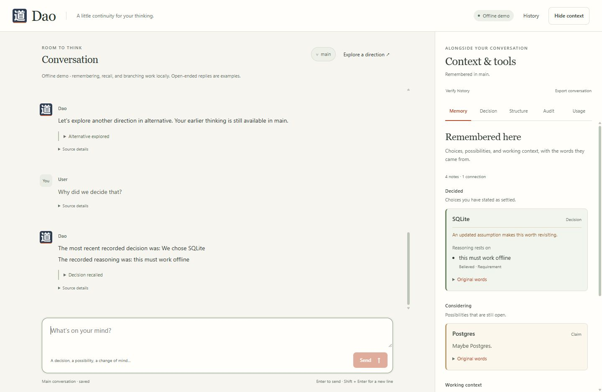

# Dao

**A flowing conversation, with room to change your mind.**

Dao is a local conversational workspace with saved revision history and branches. It can remember a decision and its reasons, distinguish an option from a commitment, preserve corrections, and recall the original conversation passages. Optional tools compare numeric decisions, review evidence, inspect relationships, and track usage.



## Windows executable

Get the current standalone **Windows x64** Dao package from the [Windows build workflow](https://github.com/Virgo-3/Dao/actions/workflows/windows-build.yml) and extract its runnable ZIP. Tagged packages are also available under [Releases](https://github.com/Virgo-3/Dao/releases). No Python installation is needed. Open PowerShell in the package folder:

```powershell
.\Dao.exe
```

The executable starts an interactive terminal. Type a message, or enter `/help` for state, branch, relationship, decision, audit, and usage commands. Use `.\Dao.exe --web --open-browser` to open the browser workspace. Both interfaces use the same saved state; the executable's default database is `%LOCALAPPDATA%\Dao\state.sqlite3`.

The executable is unsigned; compare it with the release's `SHA256SUMS`. See [Windows instructions](windows.md) for checksums, live AI configuration, and building from source. The [Windows build workflow](https://github.com/Virgo-3/Dao/actions/workflows/windows-build.yml) also supplies runnable packages.

## Run from source

Python **3.11 or newer**. No runtime packages, Node build, or API key are required for the offline demo.

```sh
git clone https://github.com/Virgo-3/Dao.git
cd Dao
python -m dao
```

Open **http://127.0.0.1:8765**. State lives in `.dao/state.sqlite3`; restarting preserves it. `python -m dao --port 9000 --db /path/to/state.sqlite3` changes the port or database.

For an interactive terminal using the same state, run `python -m dao --terminal`. Select an existing branch with `--branch NAME`. See [terminal commands and JSON imports](terminal.md) for source and executable launches.

The default **offline demo** handles common memory, recall, correction, and branching phrases locally. Its open-ended fallback is canned rather than AI inference. Messages, branches, decisions, audits, and usage are still saved. For live AI, set environment variables before starting:

```powershell
$env:DAO_PROVIDER = "openai"
$env:OPENAI_API_KEY = "your-own-key"
$env:DAO_MODEL = "gpt-4.1-mini"
python -m dao
```

```sh
export DAO_PROVIDER=openai
export OPENAI_API_KEY=your-own-key
export DAO_MODEL=gpt-4.1-mini
python -m dao
```

Use a Responses API model available to your account. Live inference sends the current conversation, saved memory, accepted relationship context, recent activity summaries, and pending structure proposals to OpenAI. The API key is sent for provider authentication and excluded from Dao's public configuration, state, and exports. The adapter uses the [Responses streaming API](https://developers.openai.com/api/docs/guides/streaming-responses), sets `store=false`, and offers bounded `evaluate_decision`, `propose_structure`, and `remember_conversation` tools. Routine memory saves low-impact context cited only to the latest user message; advanced proposals require explicit review. The model cannot accept proposals, resolve conflicts, or perform external actions. Provider tests use synthetic streams; live inference, billing, and model availability were not tested during offline verification.

`.env.example` documents the settings; Dao reads **process environment variables**, not `.env` files. Optional `pip install .` installs the `dao` command and static assets.

## Explore

Start with ordinary messages:

```text
We chose SQLite because this must work offline.
Maybe Postgres.
Actually, multiple people need to write at once.
Why did we decide that?
Let's explore another direction
Go back to main
```

The decision and its reason remain distinct from the tentative option and updated assumption. Recall preserves the original reason. A new alternative branches the saved conversation; switching back continues the destination's own context. See [talking with Dao](conversation.md) for recognized phrases and limits.

The browser's **History** panel exposes branches and revisions. **Details** exposes source passages, usage, and optional advanced tools; JSON editors and relationship diagnostics are collapsed by default. Ordinary memory needs no form or proposal review. Advanced workflows remain available:

1. Open **Details → Decision** to compare explicit probabilities, payoffs, reversibility, costs, and signal likelihoods.
2. Open **Relationships** to review a structure proposal or edit weighted relations, beliefs, and reported observations. Unresolved severe conflicts exclude their declared actions until an audit allows resolution. See the [relationship workflow](relationships.md).
3. Open **Audit** to review a claim. Source labels and reliability scores are supplied by you; meeting the policy does not establish truth. Artifact saving requires the latest matching graph-bound verdict without an action scope and no unresolved severe conflicts.
4. Open **Usage** to inspect usage, explicit key-value memory, and artifacts, or use **Export conversation** and **Verify history** from Details.
5. Restore a reachable earlier checkpoint from History or the terminal. Restore creates a new revision and preserves history and usage.

## Terms

| Term | Meaning |
| --- | --- |
| State | The messages, memory, decisions, audits, relationships, structure proposals, and artifacts at a revision |
| Revision | An immutable saved snapshot with a link to its parent |
| Checkpoint | The revision currently being viewed or selected for branching or restoration |
| Branch | A named history whose head points to its latest revision |
| Audit | A review of submitted evidence under an explicit policy, also called adjudication |
| Verdict | The audit's recorded result; permission also depends on the current state and operation |
| Artifact | Named content saved in Dao's database |

## Behavior and limits

| Capability | Runtime behavior |
| --- | --- |
| Versioned state | SHA-256-addressed snapshots with parent links; optimistic head checks reject stale writes |
| Branching | A new branch at any known revision, with its own subsequent state changes |
| Conversation memory | Exact latest-user citations; explicit mentioned, believed, considering, or decided stance; local recognition for common phrases |
| Restore | A new revision copied from a reachable ancestor; history and usage remain saved |
| Relationships | Immutable definitions, weighted beliefs, explicit unknowns, persistent conflict cases, and empirical transition estimates |
| Audit | Inspectable evidence policy; the latest matching verdict binds exact artifact content and relationship state |
| Decisions | Bayes posterior optimization, mean-variance preferences, rollback and irreversibility costs, explicit wait/abstain options |
| Usage | Atomic lifetime token reservations across branches; final usage is idempotent; unknown failures retain conservative estimated charges |
| Conversation context | Up to 1 MiB (1,048,576 bytes) of serialized UTF-8 messages, saved context, and system instructions combined |
| Model tools | Up to three model requests per turn, each reserved and accounted; one evaluation, proposal, or routine memory call per response |
| Semantic graph | At most 100 nodes, 256 relations, and 512 observations; definitions remain immutable |
| Capture and proposals | 1–32 operations, at most 128 KiB; proposals are limited to 100 per branch state |
| Browser access | Loopback-only server, Host/Origin checks, mutation CSRF token, restrictive CSP, no remote assets |

This is a **single-user local application**. Keep it bound to loopback; it has no authentication for public internet access. The owner of the database is trusted. Hash chains detect inconsistent edits, but provide no signing identity. Detecting replacement with a fully consistent older backup requires an externally trusted digest. Restoring a checkpoint preserves usage and cannot undo external actions. This release has no tools that perform external actions.

Recognized local conversation operations need no provider context or token budget and add no provider usage entry. Other turns use the configured demo or live provider. `DAO_TOKEN_BUDGET` defaults to 100,000 tokens over the database lifetime. Admission counts finalized usage plus outstanding reservations, including across branches. Reservations use conservative UTF-8 context estimates plus output caps, rather than a model-specific tokenizer; actual provider usage can exceed an estimate. Crashed requests remain reserved and continue consuming admission capacity. Failed turns retain labeled partial replies, but discard their graph and proposal changes. Browser disconnection does not stop server-side accounting.

Set both `DAO_INPUT_USD_PER_MILLION` and `DAO_OUTPUT_USD_PER_MILLION` to your contractual rates to enable estimated dollar accounting. Without configured rates the interface shows **Pricing not configured**. Costs are calculated in integer micro-USD, rounded upward; cached-token discounts and provider billing adjustments are not modeled. Offline demo token figures are estimates and have zero monetary cost. Unknown failed calls use a conservative charge at the higher configured token rate.

## Verify and develop

```sh
python -m unittest discover -s tests -v
node --check dao/static/app.js
```

The suite covers Bayesian information value, abstention and reversibility, contradictory evidence, content-bound authorization, relationship conflict persistence and action exclusion, stale/concurrent updates, global budgets, stream failures, durable restart, hash tampering, HTTP origin/CSRF protection, terminal interactions, separate application launchers, and adapter parsing with synthetic provider streams. GitHub Actions runs on Windows/Linux with Python 3.11/3.14. Node is only needed for the JavaScript syntax checks. A separate Windows workflow builds and smoke-tests both executables and publishes tagged releases.

See [talking with Dao](conversation.md), [architecture](architecture.md), [conversation structure and source passages](structure.md), [relationships](relationships.md), [decision model and derivation](decision-model.md), and [security boundaries](../SECURITY.md).
